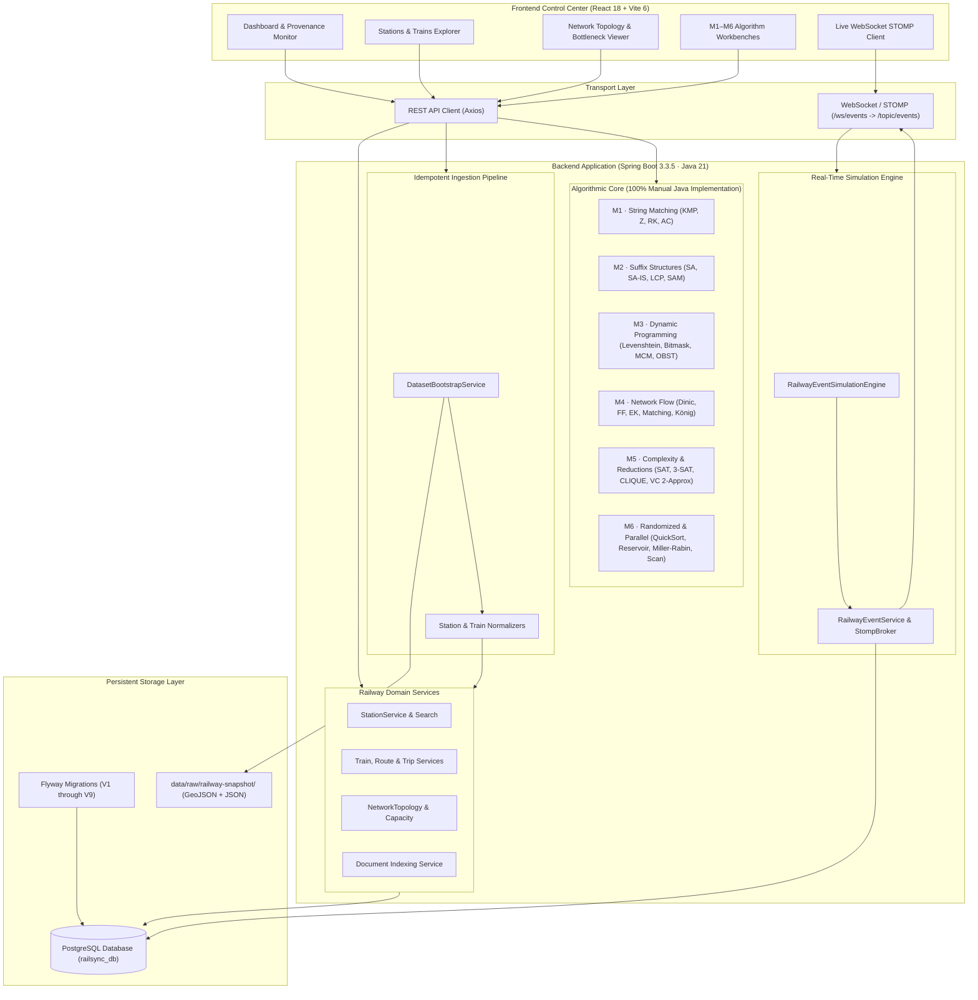
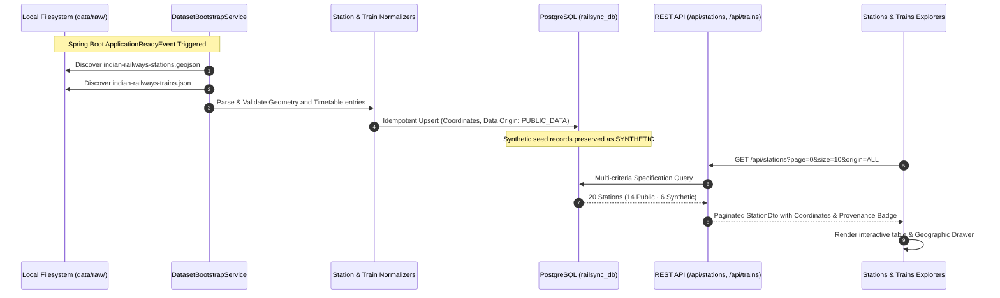
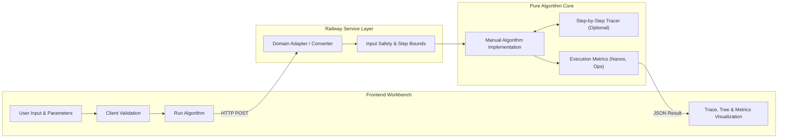
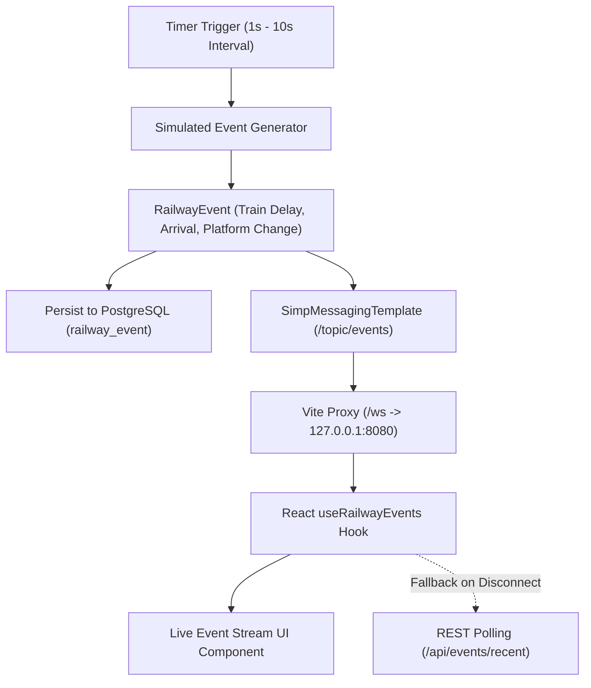

# RailSync — Academic Railway Operations Simulation & Analytics Platform

<div align="center">

[](backend/pom.xml)
[](https://openjdk.org/)
[](https://spring.io/projects/spring-boot)
[](https://www.postgresql.org/)
[](https://react.dev/)
[](https://vitejs.dev/)
[](https://tailwindcss.com/)
[](frontend/src/hooks/useRailwayEvents.js)
[](backend/src/test/)

<p align="center">
  <strong>An academic full-stack simulation and decision-support control center applying 32 Data Structures & Algorithms across 6 core syllabus modules to railway-domain operations.</strong>
</p>

</div>

---

## 🏛️ System Architecture

RailSync is engineered as a modular monolith separating presentation, domain services, persistence, real-time messaging, and purely manual algorithm cores:



---

## 🔄 Data Ingestion & Provenance Workflow

RailSync preserves strict data provenance, supporting verified real-world geographic datasets without erasing synthetic baseline records:



---

## ⚡ Algorithmic Execution Lifecycle

Every DSA module strictly isolates business presentation from core mathematical execution:



---

## 📡 Real-Time Simulation & WebSocket Pipeline

Simulated railway operational occurrences are broadcast continuously with STOMP:



---

## 📊 DSA Modules & Syllabus Matrix (CO1 – CO6)

| Module | Syllabus Title | Manual Algorithms Implemented | Railway Domain Use Case | Time Complexity | API Route |
| :---: | :--- | :--- | :--- | :---: | :--- |
| **M1** | String Algorithms | **KMP**, **Z-Function**, **Rabin-Karp**, **Aho-Corasick** | Station search, ticket code verification, multi-keyword alert detection | $O(n + m)$, $O(n + \sum m_i)$ | `/api/m1/*` |
| **M2** | Suffix Structures | **Suffix Array**, **SA-IS**, **LCP Array**, **Kasai Algorithm**, **Suffix Automaton** | Railway document indexing, duplicate bulletin detection, repeated route search | $O(n \log^2 n)$, $O(n)$ | `/api/m2/*` |
| **M3** | Advanced Dynamic Programming | **Levenshtein**, **Damerau-Levenshtein**, **Bitmask DP**, **Matrix-Chain Multiplication**, **Optimal BST** | Station name typo correction, small-scale route combination, lookup optimization | $O(nm)$, $O(n^3)$, $O(n^2 \cdot 2^n)$ | `/api/m3/*` |
| **M4** | Network Flow | **Ford-Fulkerson**, **Edmonds-Karp**, **Dinic**, **Bipartite Matching**, **König’s Theorem**, **Max-Flow Min-Cut** | Track capacity bottlenecks, platform conflict assignments, network flow bounds | $O(V \cdot E^2)$, $O(V^2 E)$ | `/api/m4/*` |
| **M5** | NP-Completeness & Approximation | **SAT Solver**, **3-SAT**, **3-SAT $\to$ CLIQUE**, **CLIQUE $\to$ IS**, **IS $\to$ Vertex Cover**, **VC 2-Approximation** | Scheduling constraint verification, conflict graph reduction, track coverage bounds | Exponential / $O(V + E)$ approx | `/api/m5/*` |
| **M6** | Randomized & Parallel | **Randomized QuickSort**, **Reservoir Sampling**, **Miller-Rabin**, **Blelloch Prefix Scan**, **Parallel Reduce**, **Brent’s Theorem** | Train priority ranking, live stream event sampling, primality demo, passenger prefix sums | Expected $O(n \log n)$, $O(k)$, Span $O(\log n)$ | `/api/m6/*` |

---

## 🛠️ Prerequisites

Ensure your development environment has the following installed:

- **Java Development Kit (JDK):** Version 21+
- **Apache Maven:** Version 3.8+
- **Node.js:** Version 18+
- **npm:** Version 9+
- **PostgreSQL Database Server:** Version 14+ (running on port `5434` or `5432`)

---

## 🚀 Quickstart & Setup Guide

### 1. PostgreSQL Database Setup

1. Start your local PostgreSQL server on port `5434` (or configured port):
2. Verify credentials matching `backend/src/main/resources/application.yml` (`postgres` / `postgres`).
3. Create the persistent database `railsync_db`:

```bash
# Using psql / createdb CLI:
createdb -U postgres -p 5434 railsync_db
```

Alternatively via `psql`:
```sql
CREATE DATABASE railsync_db;
```

---

### 2. Spring Boot Backend Setup & Startup

The backend is built with **Java 21**, **Spring Boot 3.3.5**, **Flyway**, and **PostgreSQL**.

1. Navigate to the `backend` directory:
   ```bash
   cd backend
   ```

2. Run backend test suite (327 automated tests covering M1–M6, domain services, and controllers):
   ```bash
   mvn clean test
   ```

3. Start the Spring Boot backend application:
   ```bash
   mvn spring-boot:run
   ```

   - **Backend Base URL:** `http://localhost:8080`
   - **Flyway Migrations:** Automatically applies schema migrations `V1` through `V9` on startup.
   - **Dataset Bootstrap:** Automatically discovers and bootstraps `data/raw/railway-snapshot/` into PostgreSQL idempotently.

---

### 3. Vite + React Frontend Setup & Startup

The frontend control center is built with **React 18**, **Vite 6**, **Tailwind CSS**, and **Lucide Icons**.

1. Navigate to the `frontend` directory in a second terminal:
   ```bash
   cd frontend
   ```

2. Install dependencies:
   ```bash
   npm install
   ```

3. Start the Vite development server:
   ```bash
   npm run dev
   ```

   - **Frontend Base URL:** `http://localhost:5173`
   - **Vite Proxy:** All API requests matching `/api/*` and WebSocket connections matching `/ws/*` automatically proxy to `http://127.0.0.1:8080`.

---

## 🔍 API & Endpoint Verification

### Domain & Operations Endpoints

1. **Station Directory & Search API:**
   ```bash
   curl -s "http://localhost:8080/api/stations?page=0&size=10&search=&status=ALL&dataOrigin=ALL"
   ```

2. **Trains & Transit Lines API:**
   ```bash
   curl -s "http://localhost:8080/api/trains?page=0&size=10"
   ```

3. **Train Routes & Waypoints API:**
   ```bash
   curl -s "http://localhost:8080/api/routes?trainNumber=12951"
   ```

4. **Trips & Scheduled Stop Times API:**
   ```bash
   curl -s "http://localhost:8080/api/trips?trainNumber=12951"
   ```

5. **Dataset Import & Snapshot Status API:**
   ```bash
   curl -s http://localhost:8080/api/data-import/status
   ```

6. **Trigger Idempotent Snapshot Import:**
   ```bash
   curl -s -X POST http://localhost:8080/api/data-import/snapshot
   ```

7. **Railway Documents API:**
   ```bash
   curl -s http://localhost:8080/api/documents
   ```

8. **Real-Time Simulation Events API:**
   ```bash
   curl -s http://localhost:8080/api/events/recent?limit=25
   curl -s http://localhost:8080/api/events/simulation/status
   ```

---

### Representative DSA Algorithm Endpoints (Modules M1–M6)

- **M1 String Algorithms (KMP):**
  ```bash
  curl -s -X POST http://localhost:8080/api/m1/kmp \
    -H "Content-Type: application/json" \
    -d '{"text": "Vijayawada Junction", "pattern": "Vijayawada", "traceEnabled": true}'
  ```

- **M2 Suffix Structures (Suffix Array):**
  ```bash
  curl -s -X POST http://localhost:8080/api/m2/suffix-array \
    -H "Content-Type: application/json" \
    -d '{"text": "RAILSYNC", "traceEnabled": true}'
  ```

- **M3 Advanced Dynamic Programming (Levenshtein Distance):**
  ```bash
  curl -s -X POST http://localhost:8080/api/m3/levenshtein \
    -H "Content-Type: application/json" \
    -d '{"source": "Vijayawada", "target": "Vijaywada", "traceEnabled": true}'
  ```

- **M4 Network Flow (Dinic Max-Flow):**
  ```bash
  curl -s -X POST http://localhost:8080/api/m4/dinic \
    -H "Content-Type: application/json" \
    -d '{"vertexCount": 2, "source": 0, "sink": 1, "edges": [{"u": 0, "v": 1, "capacity": 10.0, "uName": "S", "vName": "T"}], "traceEnabled": true}'
  ```

- **M5 Complexity & Approximation (SAT Solver):**
  ```bash
  curl -s -X POST http://localhost:8080/api/m5/sat \
    -H "Content-Type: application/json" \
    -d '{"variables": ["A", "B"], "stringClauses": [["A", "B"], ["!A", "B"]], "traceEnabled": true}'
  ```

- **M6 Randomized & Parallel Algorithms:**
  - **Randomized QuickSort:**
    ```bash
    curl -s -X POST http://localhost:8080/api/m6/randomized-quicksort \
      -H "Content-Type: application/json" \
      -d '{"values": [12951, 12002, 22436, 12626], "seed": 42, "traceEnabled": true}'
    ```
  - **Reservoir Sampling:**
    ```bash
    curl -s -X POST http://localhost:8080/api/m6/reservoir-sampling \
      -H "Content-Type: application/json" \
      -d '{"streamSize": 100, "k": 5, "seed": 42}'
    ```
  - **Miller–Rabin Primality Test:**
    ```bash
    curl -s -X POST http://localhost:8080/api/m6/miller-rabin \
      -H "Content-Type: application/json" \
      -d '{"n": 104729, "iterations": 5}'
    ```
  - **Blelloch Prefix Scan:**
    ```bash
    curl -s -X POST http://localhost:8080/api/m6/blelloch-scan \
      -H "Content-Type: application/json" \
      -d '{"values": [3, 1, 7, 0, 4, 1, 6, 3]}'
    ```
  - **Parallel Reduce:**
    ```bash
    curl -s -X POST http://localhost:8080/api/m6/parallel-reduce \
      -H "Content-Type: application/json" \
      -d '{"values": [10, 20, 30, 40], "threshold": 2}'
    ```
  - **Brent’s Theorem Analysis:**
    ```bash
    curl -s -X POST http://localhost:8080/api/m6/brent \
      -H "Content-Type: application/json" \
      -d '{"work": 1000, "span": 20, "processors": 8}'
    ```

---

## 🖥️ Browser Control Center Navigation

Access the following routes in your web browser (`http://localhost:5173`):

### Operations & Monitoring
- **Platform Dashboard:** `http://localhost:5173/dashboard` — Live metrics, dataset provenance, and real-time STOMP event feed.
- **Station Directory & Explorer:** `http://localhost:5173/operations/stations` — Server-side pagination, multi-field search, status/origin filters, sorting, and station detail drawer with geographic coordinates.
- **Trains & Routes Explorer:** `http://localhost:5173/operations/trains` — Train roster, service types, route waypoints, and scheduled timetable inspection.
- **Railway Network & Flow:** `http://localhost:5173/operations/network` — Station topology graph and cross-validated network flow analysis.
- **Railway Documents Index:** `http://localhost:5173/operations/documents` — Indexed operational notices and service alerts.

### Interactive DSA Workbench (M1–M6)
- **Module 1 (String Algorithms):** `http://localhost:5173/dsa/m1` (`/kmp`, `/z-function`, `/rabin-karp`, `/aho-corasick`)
- **Module 2 (Suffix Structures):** `http://localhost:5173/dsa/m2` (`/suffix-array`, `/sa-is`, `/lcp`, `/kasai`, `/suffix-automaton`)
- **Module 3 (Advanced DP):** `http://localhost:5173/dsa/m3` (`/levenshtein`, `/damerau`, `/bitmask`, `/matrix-chain`, `/optimal-bst`)
- **Module 4 (Network Flow):** `http://localhost:5173/dsa/m4` (`/ford-fulkerson`, `/edmonds-karp`, `/dinic`, `/bipartite-matching`, `/konig`, `/max-flow-min-cut`)
- **Module 5 (NP-Completeness & Approximation):** `http://localhost:5173/dsa/m5` (`/sat`, `/3sat`, `/3sat-to-clique`, `/clique-to-independent-set`, `/independent-set-to-vertex-cover`, `/vertex-cover-2approx`)
- **Module 6 (Randomized & Parallel):** `http://localhost:5173/dsa/m6` (`/randomized-quicksort`, `/reservoir-sampling`, `/miller-rabin`, `/blelloch-scan`, `/parallel-reduce`, `/brent`)

---

## 🛑 Scope & Project Guidelines

1. **Academic Simulation:** RailSync is an academic simulation and algorithmic decision-support platform, not an active railway signaling or dispatch controller.
2. **DSA Core:** All 32 required DSA algorithms in Modules M1 through M6 are manually implemented in Java without third-party algorithm libraries.
3. **No External Live API Dependency:** Operates deterministically offline using PostgreSQL synthetic and public snapshot records.
4. **Real-Time Simulation:** Simulated events are broadcast via native WebSocket and STOMP (`/ws/events` $\to$ `/topic/events`) with persistence to PostgreSQL.

---

## 📐 Authoritative Project Documentation

Authoritative documentation is located in the `docs/` folder:

- [`01-project-specification.md`](docs/01-project-specification.md) — DSA & Domain Scope
- [`02-system-architecture.md`](docs/02-system-architecture.md) — Monolith Architecture & Modules
- [`03-database-design.md`](docs/03-database-design.md) — Relational Schema & Entities
- [`04-api-contract.md`](docs/04-api-contract.md) — REST API Endpoints & Envelopes
- [`05-algorithm-contracts.md`](docs/05-algorithm-contracts.md) — Algorithm Signatures & Trace Specification
- [`06-ui-architecture.md`](docs/06-ui-architecture.md) — React Frontend Control Center Design
- [`07-testing-strategy.md`](docs/07-testing-strategy.md) — Backend & Frontend Test Suite Guidelines
- [`08-development-roadmap.md`](docs/08-development-roadmap.md) — Development Phases & Milestone Progress
